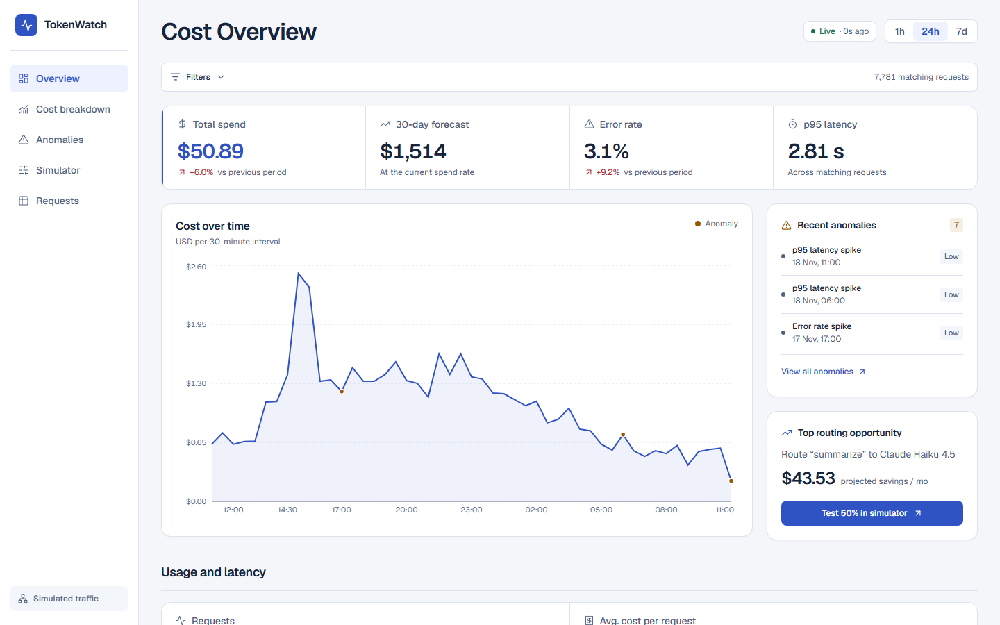
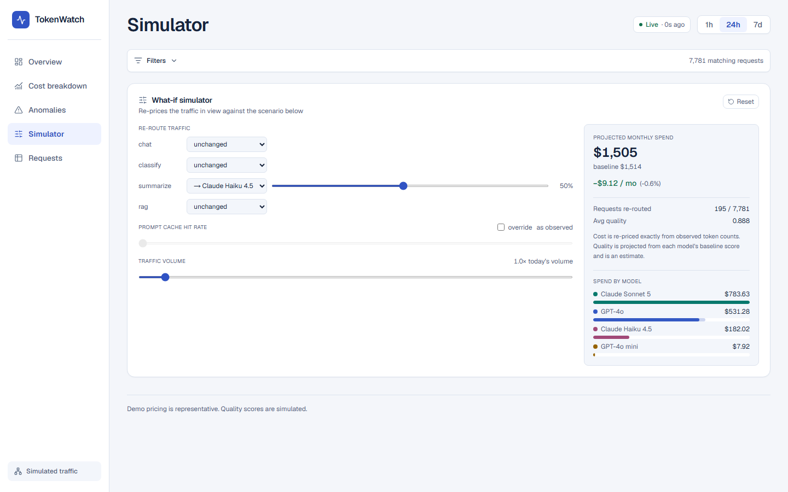

# TokenWatch

**An LLM cost dashboard for investigating spend and testing routing changes.**

TokenWatch shows how much each model and endpoint costs, flags unusual spending or performance, and lets you test a new configuration against the same traffic. A seeded event stream drives the demo, so you can try it without an LLM API key.

[Open the live demo](https://llm-cost-dashboard-omega.vercel.app/) · [Read the engineering notes](docs/README.md)



## Try an investigation

1. Open **Overview** and select an anomaly. The cost chart marks the incident interval. **View related requests** opens the request log filtered to that interval.
2. Open **Cost breakdown** to see which models and endpoints account for the spend.
3. Return to **Overview** and select **Test 50% in simulator**. The simulator compares projected monthly spend and estimated quality against the current configuration.



## How it works

Deterministic request events are stored in DuckDB and aggregated in SQL. A Next.js API pushes new snapshots to the dashboard over Server-Sent Events.

- **Ingestion.** Time-based seeding makes incremental appends agree with a single backfill for the same interval. [Generator and tests](lib/generator.test.ts)
- **Anomaly detection.** A rolling median and median absolute deviation flag changes in cost, error rate, and p95 latency. Each bucket is compared with earlier buckets. [Anomaly queries](lib/db/anomalies.ts)
- **Scenario pricing.** The simulator changes model routing, cache hit rate, or traffic volume and joins the result to the model price table. [Simulation query](lib/db/simulate.ts)

The event stream and quality scores are synthetic. Model prices are illustrative, and savings are projections based on the demo data.

## Run locally

Use Node.js 22, the version used in CI.

```bash
npm ci
npm run dev
```

Open [http://localhost:3000](http://localhost:3000). The first request backfills seven days of simulated traffic by default.

```bash
npm run verify
npm run build
```

The tests check SQL results against an independent TypeScript implementation. CI also builds the app and verifies that a newly seeded DuckDB file can be queried. [Test suite](lib/db/reconcile.test.ts) · [CI workflow](.github/workflows/ci.yml)

**Stack** · Next.js · React · TypeScript · Tailwind CSS · Recharts · DuckDB · Vitest

**License** · [MIT](LICENSE)
