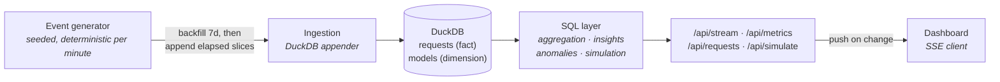

# TokenWatch — LLM Cost Intelligence

A live cost-observability dashboard for LLM traffic, built on a real analytics
pipeline: simulated events are **ingested** into a DuckDB store, **transformed**
by SQL, and **served** over Server-Sent Events. It finds where money is being
wasted, flags incidents statistically, and lets you re-price your traffic
against a hypothetical setup before changing anything.

**[Live demo](#)** · _add your Vercel URL here once deployed_

> **Screenshots pending.** See [`docs/README.md`](docs/README.md) for what to
> capture. Once `docs/screenshot-dashboard.png` exists, replace this block with:
> ``

---

## The problem

LLM spend is easy to measure and hard to act on. A finance export tells you that
last month cost $4,200; it does not tell you that a third of it went to running
a frontier model on a classification task a small model handles fine, or that a
bad deploy on Tuesday quietly tripled your error rate for forty minutes while
you kept paying for the input tokens.

This dashboard is built around three questions a cost report does not answer:

| Question | How it is answered |
|---|---|
| **Where is money leaking?** | Cost cross-tabbed by endpoint × model. Over-provisioned routing shows up as an expensive band inside a cheap workload's bar. |
| **When did something break?** | Rolling-median anomaly detection over cost, error rate and p95 latency. |
| **What if I changed it?** | A simulator that re-prices the real traffic against a scenario — different routing, a different cache hit rate, more volume. |

---

## Architecture



**Ingestion → storage → transformation → serving.** Every number on screen is
produced by a SQL query against the fact table — nothing is aggregated in
JavaScript.

| Layer | Where | What it does |
|---|---|---|
| Generation | `lib/generator.ts` | Poisson arrivals, log-normal tokens and latency, a diurnal traffic curve, and deterministic incidents |
| Ingestion | `lib/db/client.ts` | 7-day backfill through DuckDB's appender, then continuous sub-minute appends |
| Schema | `lib/db/schema.ts` | `requests` fact table + `models` price-book dimension |
| Transformation | `lib/db/{queries,insights,anomalies,simulate}.ts` | All aggregation, in SQL |
| Serving | `app/api/*` | SSE stream, snapshot endpoint, drill-down, simulator |

---

## Engineering notes

The decisions worth explaining, and why they went the way they did.

### The SQL is checked against a second implementation

`lib/aggregate.ts` is a pure-TypeScript roll-up that computes the same summary
the SQL layer does. It is not dead code — the test suite runs both over an
identical event stream and asserts they agree, down to per-bucket per-model
cost and interpolated latency percentiles.

Two independent implementations of one spec disagree only if one of them is
wrong. That is a much stronger check than asserting either against hand-written
expected values, which mostly tests that you can do arithmetic twice the same
way. The same pattern covers the savings insights and the median/MAD used by
the anomaly detector.

### Incremental ingestion had to be provably equivalent to a backfill

The store appends only the time that has actually elapsed since the last tick —
a few seconds' worth. For the history to be correct, appending in slices must
produce exactly what one large backfill would have produced.

That holds because generation is seeded from each minute's **absolute index**
rather than from a running PRNG, so:

```
generateRange(a, c) === generateRange(a, b) ++ generateRange(b, c)
```

for any split point `b`, including mid-minute. `lib/generator.test.ts` asserts
it at minute boundaries, mid-minute, and across many small slices.

### Mean and standard deviation are the wrong tools for anomaly detection

The obvious detector — flag anything beyond 3σ — fails on exactly the data it
is meant to police. Both the mean and the standard deviation are dragged around
by the spikes being detected, so one incident inflates the threshold enough to
mask the next, and a sustained outage quietly becomes the new normal.

The detector uses a rolling **median** baseline and **median absolute
deviation**, scored with the Iglewicz–Hoaglin modified z-score. Both statistics
have a 50% breakdown point. The point under test is excluded from its own
baseline, since including it pulls the median toward the value being judged.

A first version could not detect error storms *at all*. A healthy service sits
at exactly zero errors, so more than half the trailing window shares a value,
MAD collapses to zero, and the metric most worth alerting on could never fire.
Each metric now has a floor on its spread estimate — which doubles as a
practical-significance gate, so a metric that normally varies by a rounding
error does not raise an alert for varying by two rounding errors.

Because window functions cannot be nested, MAD is computed by collecting the
trailing window with `array_agg() OVER` and reducing it with list lambdas —
exact, rather than the common shortcut of deviating from a per-row median.

### Pricing lives in a table, which is what makes the simulator cheap

`models` is a dimension table, not just a TypeScript constant. Asking "what
would this traffic have cost on a different model?" is therefore a **join**, not
a loop — so re-pricing 54,000 requests under a new scenario is one pass over the
fact table rather than 54,000 iterations in JavaScript.

The moved subset is chosen with `hash(id) % 1000`, so the same request always
lands on the same side of a split. Nudging one slider never reshuffles which
calls moved, and the projection settles instead of jittering.

### One DuckDB connection is not a connection pool

The first version shared a single connection across all requests. One request
worked fine; two overlapping ones **deadlocked the server**, because a
connection executes one statement at a time and each page load fans out several
queries.

Writes now go through one dedicated connection behind a mutex — two overlapping
ingests would otherwise append the same slice twice — while readers borrow their
own short-lived connection. Verified with 12 concurrent requests and pinned by
`lib/db/concurrency.test.ts`.

### The "live" indicator tells the truth

The earlier version polled every 5 seconds and rendered an animated "live"
badge, while the underlying data only changed once a minute — eleven of every
twelve responses were byte-identical. Now the server pushes over SSE only when
the payload actually changes, and the indicator reports real `EventSource` state:
`connecting`, `live`, `reconnecting`, `disconnected`, plus how long ago the last
frame landed.

---

## Honesty about the numbers

A cost dashboard that overstates savings is worse than no dashboard, so the
distinction is built into the data model rather than the copy.

- **Savings are split into `measured` and `estimate`.** Re-routing savings are
  re-priced from observed token counts against the price book — exact. The
  prompt-caching recommendation rests on an assumption the event stream cannot
  confirm (it carries no prompt text to diff), and is labelled and totalled
  separately.
- **Every routing recommendation carries its quality cost.** `qualityDelta` is
  shown next to the dollar figure, because a saving that silently trades away
  output quality is not a saving.
- **The simulator separates exact from projected.** Cost is re-priced from real
  token counts. Projected quality is an estimate from each model's baseline
  score, and the panel says so.
- **Recommendations operate on disjoint endpoint sets**, so summing them does
  not double-count. Adding an overlapping recommendation would break that and
  needs the overlap netted out first.

### About the data

The event stream is **simulated** — no LLM API is called and no real traffic is
involved. It is shaped to behave like production traffic (Poisson arrivals,
log-normal token and latency distributions, a diurnal curve, and incidents), and
it contains deliberate inefficiencies for the analysis to find.

Model pricing is **representative, not a live price book**. The figures are
realistic and the *relationships* are what matter: output costs several times
input, cached input is far cheaper than fresh, and a frontier model costs
15–20× a small one for a modest quality gain.

---

## Running it

```bash
npm install
npm run dev          # http://localhost:3000
```

The store backfills seven days of history on first request (~54,000 events,
under a second) and then ingests continuously.

```bash
npm run verify       # typecheck + lint + tests
npm run test:watch   # tests in watch mode
npm run build        # production build
```

### Querying the data yourself

The dashboard's claims should be checkable without trusting the dashboard.
`npm run seed` writes the same schema to a file you can open in the DuckDB CLI:

```bash
npm run seed                              # 7 days, default settings
npx tsx scripts/seed.ts --hours 24        # pass flags via tsx, not `npm run --`
duckdb data/events.duckdb
```

```sql
-- The routing leak the Insights panel reports, found by hand.
SELECT endpoint, model,
       count(*)              AS calls,
       round(sum(cost_usd),2) AS usd
FROM v_requests
WHERE endpoint = 'classify'
GROUP BY 1, 2
ORDER BY usd DESC;
```

### Configuration

Everything is optional; see `.env.example`.

| Variable | Default | Purpose |
|---|---|---|
| `SIM_SEED` | `42` | PRNG seed — the same seed replays the same history |
| `SIM_RATE_PER_MIN` | `8` | Nominal traffic rate, before the diurnal curve |
| `SIM_RETENTION_HOURS` | `168` | How much history the store keeps |
| `DUCKDB_PATH` | `:memory:` | Store location; a path persists between restarts |

---

## Testing

```
85 unit tests   ·  6 files
27 end-to-end checks against a production build
```

The suite is weighted toward things that are easy to get quietly wrong:

- **Reconciliation** — SQL aggregation vs. the independent TypeScript
  implementation, per bucket and per model
- **Determinism** — the concatenation identity that incremental ingestion
  depends on, at minute boundaries, mid-minute, and across many small slices
- **Statistics** — median/MAD properties including "unmoved by an outlier" and
  "not blinded by an earlier spike in its own history"
- **Detection** — a planted incident, asserting all three metrics fire on the
  right bucket and nothing fires on the ordinary ones
- **Simulation** — the empty scenario must re-price to exactly the observed
  spend, or every other projection is built on a broken foundation
- **Concurrency** — the regression that deadlocked the server
- **Input validation** — unknown filter values are dropped rather than matched;
  scenario input is clamped

CI runs typecheck, lint, tests and a build on every push, then seeds a DuckDB
file and queries it back to prove the pipeline works on a clean machine.

---

## Known limitations

Stated rather than hidden, because they are the honest boundaries of a
weekend-scale project:

- **The store is per-instance.** On serverless, each cold start rebuilds its own
  in-memory store. Fine for a demo; a real deployment would point `DUCKDB_PATH`
  at shared storage or use MotherDuck.
- **The stream recomputes per subscriber.** Every connected client triggers its
  own query pass every two seconds. A shared computation fanned out to
  subscribers would scale further.
- **Dark theme only.** No light mode yet.
- **Quality is synthetic.** `qualityScore` is a generated proxy, not a real
  evaluation. Wiring in an actual eval harness is the most valuable next step.

---

## Stack

Next.js 16 (App Router) · React 19 · TypeScript 6 · Tailwind CSS v4 ·
Recharts 3 · DuckDB 1.5 · Vitest 4

## License

MIT — see [LICENSE](LICENSE).
